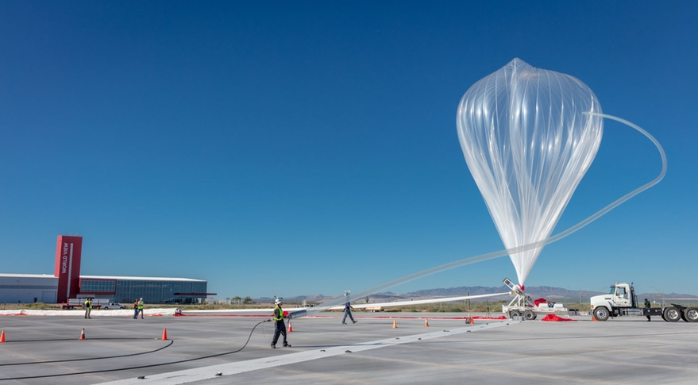

# Forward Seam Carving

Content-aware image resizing with **seam carving** using the **forward energy** criterion
([Rubinstein, Shamir & Avidan, 2008](https://dl.acm.org/doi/10.1145/1360612.1360615)), written in C++ with OpenCV.

A *seam* is a connected path of pixels from one side of the image to the other. On each key press the
program finds the cheapest seam and removes it (shrinking the image by one pixel) or duplicates it
(growing the image by one pixel). Low-detail areas like sky or grass absorb the change, so the
important objects keep their shape.

The cost is computed with *forward energy*: each seam is scored by how much new edge energy
removing it would **create** (the differences between pixels that become neighbours), not by how much
energy it currently has. This gives fewer jagged artefacts than the classic backward-energy approach.

> Project for **ITCS381 Introduction to Multimedia Systems**, Faculty of Information and
> Communication Technology (MUICT), Mahidol University.

## Results

Each image has had **200 vertical seams removed** (`a` pressed 200 times).

| Original | Seam carved (−200 px width) |
| --- | --- |
|  |  |
| 879 × 485 | 679 × 485 |
|  |  |
| 1000 × 662 | 800 × 662 |
|  |  |
| 800 × 561 | 600 × 561 |

## How it works

For each pixel `(i, j)` of the greyscale image, three forward-energy costs are computed:

```
CU = |I(i, j+1) − I(i, j−1)|                     seam comes from directly above
CL = CU + |I(i−1, j) − I(i, j−1)|                seam comes from the upper-left
CR = CU + |I(i−1, j) − I(i, j+1)|                seam comes from the upper-right
```

These fill a cumulative cost matrix `M` with dynamic programming:

```
M(i, j) = min( M(i−1, j−1) + CL,  M(i−1, j) + CU,  M(i−1, j+1) + CR )
```

A second matrix `K` records which of the three moves was chosen. The best seam starts at the minimum
of the last row of `M` and is traced back through `K`. Horizontal seams work the same way on columns.

## Controls

| Key | Action |
| --- | --- |
| `a` | Remove a vertical seam (width − 1) |
| `d` | Insert a vertical seam (width + 1) |
| `s` | Remove a horizontal seam (height − 1) |
| `w` | Insert a horizontal seam (height + 1) |
| `Esc` | Quit |

In interactive mode the program also shows the cost matrix `M` and the chosen seam in separate
windows, and saves the latest step to `Delete_*.jpg` / `Increase_*.jpg` in the working directory.

## How to run

You need **OpenCV** (3.4 or newer).

### macOS / Linux

```bash
# macOS
brew install opencv pkg-config
# Ubuntu / Debian
sudo apt install libopencv-dev pkg-config

make                                   # builds build/seam_carving
./build/seam_carving images/1.jpg      # opens a window, then use the keys above
```

To run without a window, pass the key presses as a string. For example, to remove 200 vertical seams
and save the result:

```bash
./build/seam_carving images/1.jpg --keys "$(printf 'a%.0s' {1..200})" --out carved.jpg
```

### Windows (Visual Studio)

1. Install OpenCV to `C:\opencv` (the project expects `C:\opencv\build\include` and
   `C:\opencv\build\x64\vc14\lib` with `opencv_world340d.lib`. Change these under
   *Project → Properties* if your version or path differs).
2. Open `msvc/SeamCarving.sln` in Visual Studio 2017 or newer.
3. Build and run the **Debug | x64** configuration. It runs from the repository root, so it loads
   `images/1.jpg` by default. Set a different image under *Debugging → Command Arguments*.

## Project structure

```
.
├── src/seam_carving.cpp   # forward-energy seam carving implementation
├── images/                # sample input photos
├── results/               # before-and-after outputs shown above
├── msvc/                  # Visual Studio 2017 solution
└── Makefile               # macOS / Linux build
```
